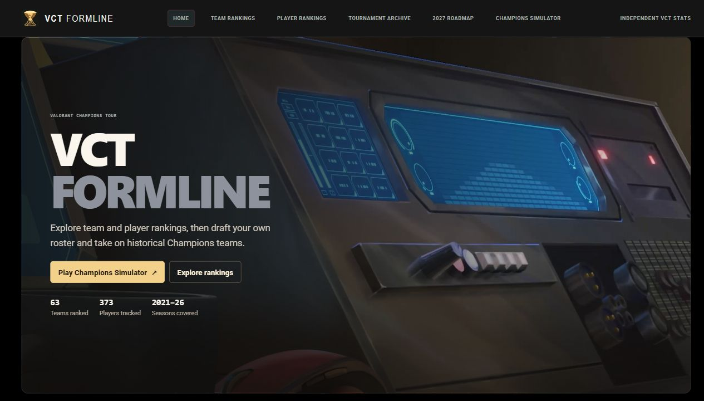
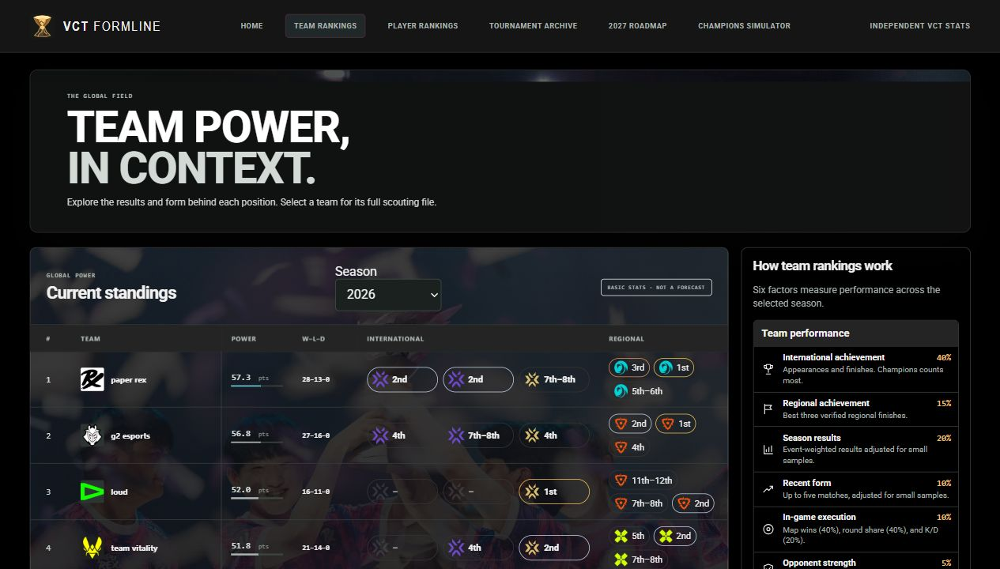
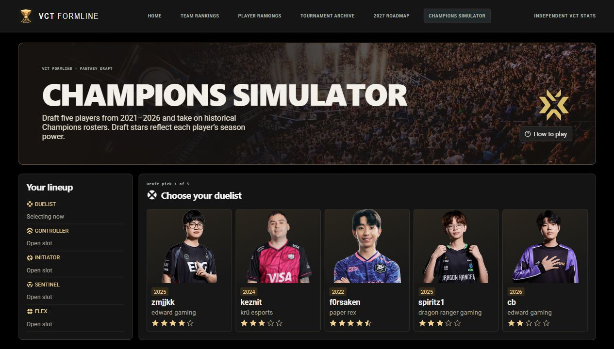

# VCT Formline

An independent VALORANT Champions Tour explorer and fantasy tournament simulator. Compare teams and players across the 2021–2026 seasons, browse past events, and draft a roster to face historical Champions lineups.

**[Open the live app](https://vct-formline.vercel.app/)** · [Team rankings](https://vct-formline.vercel.app/#teams) · [Player rankings](https://vct-formline.vercel.app/#players) · [Champions Simulator](https://vct-formline.vercel.app/#simulator)

[](https://vct-formline.vercel.app/)

## Explore the app

| Feature | What you can do |
| --- | --- |
| [Team rankings](https://vct-formline.vercel.app/#teams) | Compare season power, series records, regional and international finishes, and regional strength. |
| [Player rankings](https://vct-formline.vercel.app/#players) | Search players and inspect roles, agent picks, map stats, roster history, and tournament achievements. |
| [Tournament archive](https://vct-formline.vercel.app/#archive) | Filter imported Tier 1 events by season and circuit. |
| [2027 roadmap](https://vct-formline.vercel.app/#watchlist) | Follow the four regional circuits and the path to Masters Seoul, Masters Valencia, and Champions Austin. |

[](https://vct-formline.vercel.app/#teams)

### Champions Simulator

Draft a Duelist, Controller, Initiator, Sentinel, and Flex from historical player seasons. Pick a region and play through a group stage and double-elimination playoffs against historical Champions rosters. The draft uses season power to show player strength in half-star increments. Each simulated series includes map results, agent compositions, and an MVP.

[](https://vct-formline.vercel.app/#simulator)

## Data and ranking methodology

The Python ingestion pipeline collects event, match, and player-map data from [VLR.gg](https://www.vlr.gg/). It stores normalized records in PostgreSQL. VCT Formline also tracks sourced roster tenures and match appearances.

- **Team power** combines international achievement (40%), regional achievement (15%), season results (20%), recent form (10%), in-game execution (10%), and opponent strength (5%).
- **Player power** combines sample-adjusted season performance (65 points), maps played (10), international performance (10), and verified tournament finishes (15). Players qualify after five maps.
- Rankings summarize imported results for the selected season. Simulator outcomes are fictional and use historical data for player strength and agent picks.

**Stack** · Python, PostgreSQL, FastAPI, and vanilla JavaScript. Production runs on Vercel with hosted PostgreSQL.

## Run locally

Install Python 3.9+ and PostgreSQL. From the repository root, install dependencies, create a database, and copy the environment template. The commands below use PowerShell.

```powershell
python -m pip install -r requirements.txt
createdb -U postgres vct_db
Copy-Item .env.example .env
```

Set the PostgreSQL connection values in `.env`, then initialize the schema and start the app.

```powershell
python -m src.db.initialize
python -m src.web.app
```

Open the [local app](http://127.0.0.1:8000/). An empty database needs an import before rankings and historical simulator rosters can load.

### Import or refresh data

```powershell
python -m src.scraper.main
python -m src.db.import_vlr
python -m src.db.sync_vlr_profiles --historical-events
```

The default scrape starts on January 1 of the current UTC year and writes snapshots to `data/raw/`. For a resumable historical import, run `python -m src.scraper.main --backfill --since 2021-01-01 --through-year 2026`. The backfill imports each event as it finishes and skips matches that already have player-map stats.

Run tests with `python -m unittest discover -s tests -v`.

## Deployment

Import the repository root into Vercel as a FastAPI project. Set `DATABASE_URL` to the hosted PostgreSQL connection string, initialize or restore the database, and verify `/api/health` after deployment. See the [project workflow](workflow.md) for architecture, ingestion, roster evidence, and validation.

VCT Formline is independent and unaffiliated with Riot Games. The screenshots were captured from the live app.
